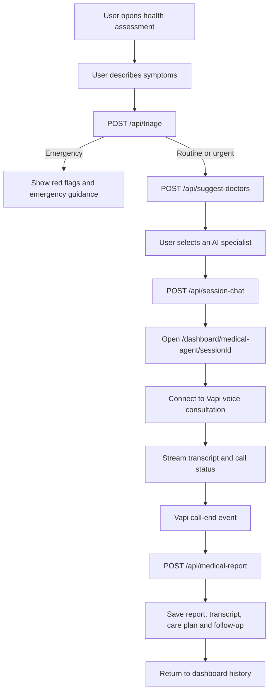

# CuraAi 🩺🎙️

CuraAi is a voice-first digital healthcare platform for starting a symptom assessment, finding a relevant AI specialist, completing a real-time voice consultation, and keeping the resulting health record organized.

Users can:

- Describe symptoms by text and receive an urgency assessment.
- Receive emergency guidance when red flags are detected.
- Get matched with an AI health specialist from the existing specialist catalog.
- Complete a real-time Vapi voice consultation.
- Review a live transcript while the consultation is in progress.
- Receive a structured consultation report after disconnecting.
- View care-plan steps and scheduled follow-up recommendations.
- Upload JPG, PNG, TXT, CSV, or JSON medical reports for an educational explanation.

> **Important:** CuraAi provides AI-generated informational support. It is not a diagnostic service and must not be used for medical emergencies. Contact local emergency services or a licensed professional when appropriate.

## 🏗️ System Architecture & Workflow



## 🩺 Product Workflow

### 1. Onboarding and dashboard

- Authentication is handled by **Clerk**.
- Protected dashboard and API routes require an authenticated user.
- The dashboard provides Overview, Consultations, Documents, and Billing navigation.
- The responsive dashboard includes consultation history, upcoming follow-ups, document analysis, and the existing AI specialist catalog.

### 2. Health assessment, triage and specialist matching

The multi-step assessment dialog:

1. Collects the user's symptoms.
2. Sends them to `/api/triage`.
3. Classifies the request as `EMERGENCY`, `URGENT`, or `ROUTINE`.
4. Stops emergency cases and displays red flags plus immediate-care guidance.
5. Sends routine and urgent cases to `/api/suggest-doctors`.
6. Lets the user select a recommended specialist.

The current specialist catalog includes General Physician, Pediatrician, Dermatologist, Psychologist, Nutritionist, Cardiologist, ENT Specialist, Orthopedic, Gynaecologist, and Dentist personas.

### 3. Session initialization

Selecting a specialist sends `POST /api/session-chat`. The API creates a UUID-based session containing the symptom note and selected specialist, then the user is redirected to:

```text
/dashboard/medical-agent/[sessionId]
```

### 4. Live voice consultation

The consultation page:

- Initializes the Vapi Web SDK.
- Starts the configured Vapi assistant with specialist-specific prompt overrides.
- Restricts the assistant to relevant medical topics.
- Shows connection state, elapsed time, live transcript, and the disconnect action.
- Captures final and partial transcript messages safely in the browser.

### 5. Structured report generation

When Vapi emits `call-end`, the client waits briefly for final transcript events, includes any remaining partial transcript, and calls `POST /api/medical-report`.

The generated report includes:

- `chiefComplaint`
- `summary`
- `symptoms`
- `duration`
- `severity`
- `medicationsMentioned`
- `recommendations`
- `carePlan`
- `followUp`
- `emergencyWarning`
- `user`

The `user` field uses a name explicitly stated by the patient in the conversation. If no name is stated, it is set to `Anonymous`. The report and full transcript are saved to the consultation record.

### 6. Care plans and follow-ups

Reports can recommend practical, non-prescriptive care-plan steps and a follow-up interval. Recommended follow-ups are stored once per consultation and shown in the dashboard.

### 7. Medical document analyzer

The Documents page is available at `/dashboard/documents`. It supports:

- JPG and PNG image reports
- TXT, CSV, and JSON text reports
- Patient-friendly summaries
- Reported values, units, reference ranges, and status labels
- Educational context
- Questions to discuss with a clinician

PDF extraction and persistent document storage are not currently enabled. PDF files are intentionally excluded from the upload selector.

## 🗄️ Database Schema

The database uses **PostgreSQL** hosted by **Neon** and managed through **Drizzle ORM**.

### `users`

Stores authenticated patient profile data:

- `id`: Integer primary key
- `name`: Varchar(255)
- `email`: Varchar(255), unique
- `credits`: Integer, default `0`

### `session_chat`

Stores consultation data:

- `id`: Integer primary key
- `sessionId`: Varchar(255), UUID
- `note`: Text, initial symptom description
- `selectedDoctor`: JSON specialist metadata
- `conversation`: JSON transcript messages
- `report`: JSON structured medical report
- `createdBy`: Varchar(255), foreign key to `users.email`
- `createdOn`: Varchar(255), creation timestamp

### `follow_ups`

Stores scheduled follow-up recommendations:

- `id`: Integer primary key
- `consultationId`: Integer, foreign key to `session_chat.id`
- `userEmail`: Varchar(255), foreign key to `users.email`
- `scheduledFor`: Timestamp with timezone
- `reason`: Text
- `status`: Varchar(32), default `scheduled`
- `createdAt`: Timestamp with timezone

## 🛠️ Technology Stack

- **Frontend:** Next.js 16, React 19, App Router, Turbopack
- **Styling:** Tailwind CSS 4 and Radix-based UI components
- **Database:** PostgreSQL, Neon Database, Drizzle ORM
- **Authentication:** Clerk
- **Voice:** Vapi Web SDK
- **Speech provider:** Configured through Vapi
- **AI:** Google Gemini through the OpenAI-compatible API
- **Voice intelligence:** OpenAI `gpt-4o-mini` through Vapi
- **Icons:** Lucide React and existing Tabler UI components
- **Notifications:** Sonner

## 🚀 Getting Started

### 1. Configure environment variables

Create a `.env` or `.env.local` file in the project root:

```env
DATABASE_URL=your_postgresql_connection_string

NEXT_PUBLIC_CLERK_PUBLISHABLE_KEY=your_clerk_publishable_key
CLERK_SECRET_KEY=your_clerk_secret_key

NEXT_PUBLIC_VAPI_API_KEY=your_vapi_public_api_key
NEXT_PUBLIC_VAPI_VOICE_ASSISTANT_ID=your_vapi_assistant_id

GEMINI_API_KEY=your_google_gemini_api_key
GEMINI_MODEL=gemini-2.0-flash
```

`GEMINI_MODEL` is optional and can be set to a model enabled for the Google project associated with the API key.

### 2. Install dependencies

```bash
npm install
```

### 3. Synchronize the database

After setting `DATABASE_URL`, apply the Drizzle schema:

```bash
npm run db:push
```

Review Drizzle's proposed changes before confirming them. Do not accept a destructive drop-and-recreate operation when the database contains existing consultation records.

### 4. Run the development server

```bash
npm run dev
```

Open [http://localhost:3000](http://localhost:3000).

## 📁 Important Routes

| Route | Purpose |
| --- | --- |
| `/` | Public CuraAi landing page |
| `/dashboard` | Health-record overview and consultation entry point |
| `/dashboard/history` | Previous consultation reports |
| `/dashboard/documents` | Medical document analyzer |
| `/dashboard/billing` | Clerk billing and plan management |
| `/dashboard/medical-agent/[sessionId]` | Live Vapi consultation |

## 🔌 API Routes

| Method | Route | Purpose |
| --- | --- | --- |
| `POST` | `/api/triage` | Assess urgency and identify emergency red flags |
| `POST` | `/api/suggest-doctors` | Recommend relevant AI specialists |
| `POST` | `/api/session-chat` | Create a consultation session |
| `GET` | `/api/session-chat?sessionId=...` | Read an authenticated session or history |
| `POST` | `/api/medical-report` | Generate and save the consultation report |
| `POST` | `/api/documents/analyze` | Analyze a supported medical document |
| `GET` | `/api/followups` | List authenticated user follow-ups |
| `POST` | `/api/followups` | Create a follow-up |

## ⚠️ Safety and Privacy Notes

- CuraAi is not an emergency service and does not replace licensed medical care.
- Do not commit `.env` files or expose API keys in source control.
- API routes verify Clerk authentication before reading or writing user-specific data.
- Session and follow-up queries are scoped to the authenticated user's email.
- Medical report and document-analysis output is educational and should be reviewed with a qualified clinician.
